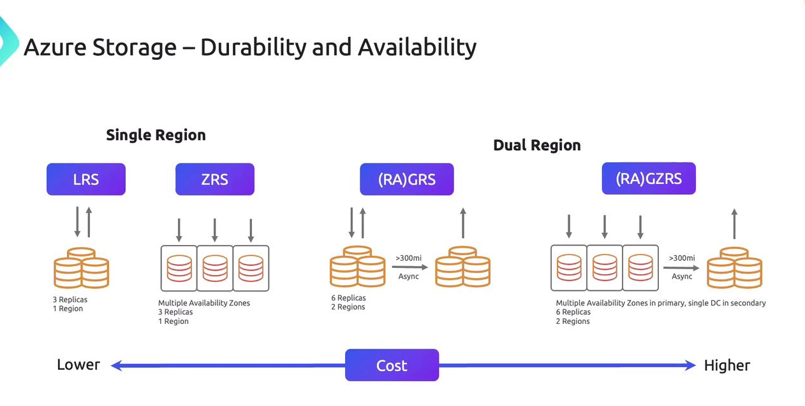
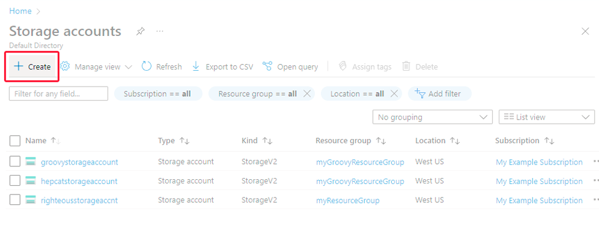

# ☁️ Laboratório DIO: Alta Disponibilidade, SLA e Redundância no Microsoft Azure

Este repositório documenta os conceitos arquiteturais e práticos abordados durante o laboratório da trilha **Microsoft Azure Fundamentals (AZ-900)** na **DIO (Digital Innovation One)**, com foco em resiliência de infraestrutura, acordos de nível de serviço e redundância de dados.

## 🎯 Objetivos de Aprendizagem

* Compreender as métricas de **SLA (Service Level Agreement)** e calcular o tempo máximo de inatividade permitido.
* Configurar e diferenciar as opções de **Alta Disponibilidade** para Máquinas Virtuais (conjuntos e zonas de disponibilidade).
* Entender as estratégias de **redundância em Contas de Armazenamento (Azure Storage)**.
* Analisar como a **replicação de dados entre regiões** impacta o SLA e a recuperação de desastres.

---

## 📊 1. Métricas de SLA no Azure (Tempo de Inatividade)

O **SLA (Acordo de Nível de Serviço)** define o compromisso formal da Microsoft em relação à disponibilidade (uptime) de um serviço. Quanto maior o percentual de SLA, menor é o tempo máximo permitido de indisponibilidade (*downtime*):

| Percentual de SLA | Tempo de Inatividade por Semana | Tempo de Inatividade por Mês (~30 dias) | Tempo de Inatividade por Ano (365 dias) |
| :--- | :--- | :--- | :--- |
| **99%** | 1 hora e 40 minutos | 7 horas e 18 minutos | 3 dias e 15 horas |
| **99,9%** | 10 minutos e 4 segundos | 43 minutos e 49 segundos | 8 horas e 45 minutos |
| **99,95%** | 5 minutos e 2 segundos | 21 minutos e 54 segundos | 4 horas e 22 minutos |
| **99,99%** | 1 minuto e 4 segundos | 4 minutos e 23 segundos | 52 minutos e 35 segundos |
| **99,999%** | 6 segundos | 26 segundos | 5 minutos e 15 segundos |

> **Nota sobre SLA Composto:** Quando uma arquitetura depende de múltiplos serviços em conjunto (ex.: uma VM conectada a um Banco de Dados SQL), o SLA final da solução é o produto dos SLAs individuais de cada recurso envolvido.

---

## 🏢 2. Opções de Disponibilidade e Zonas de Disponibilidade

Para proteger aplicações e Máquinas Virtuais contra falhas de hardware, rede ou desastres físicos no datacenter, o Azure oferece diferentes níveis de resiliência:

* **Conjuntos de Disponibilidade (Availability Sets):** Agrupam VMs dentro de um **único datacenter**, distribuindo-as em diferentes **Domínios de Falha** (racks físicos distintos com fontes de energia e rede separadas) e **Domínios de Atualização** (garantindo que manutenções planejadas não reiniciem todas as máquinas simultaneamente).
* **Zonas de Disponibilidade (Availability Zones):** São locais físicos separados dentro de uma **mesma região do Azure**. Cada zona possui um ou mais datacenters equipados com energia, refrigeração e rede independentes.
  * **Quantas zonas podem ser aplicadas?** Uma região do Azure que suporta Zonas de Disponibilidade conta com **no mínimo 3 zonas distintas** (Zona 1, Zona 2 e Zona 3). Ao distribuir instâncias entre essas 3 zonas, o Azure eleva o SLA de disponibilidade das Máquinas Virtuais para **99,99%**.

---

## 💾 3. Contas de Armazenamento (Azure Storage) e Redundâncias

O **Azure Storage** sempre mantém múltiplas cópias dos seus dados para protegê-los contra falhas de hardware e eventos catastróficos. As opções de redundância dividem-se em dois cenários principais:

### Redundância na Região Primária
* **LRS (Armazenamento com Redundância Local):** Copia os dados **3 vezes** de forma síncrona dentro de um único datacenter na região primária. É a opção mais econômica, protegendo contra falhas de disco/rack, mas vulnerável se o datacenter inteiro ficar indisponível.
* **ZRS (Armazenamento com Redundância de Zona):** Copia os dados de forma síncrona entre **3 Zonas de Disponibilidade** distintas dentro da mesma região primária, garantindo alta disponibilidade mesmo na queda de um datacenter inteiro.

### Redundância em Região Secundária (Geográfica)
* **GRS (Armazenamento com Redundância Geográfica):** Combina o LRS na região primária (3 cópias) com a replicação assíncrona para uma **região secundária emparelhada** (mais 3 cópias via LRS), totalizando **6 cópias** dos dados.
* **GZRS (Armazenamento com Redundância de Zona Geográfica):** Combina a alta disponibilidade do **ZRS** na região primária (3 zonas) com a proteção regional do **GRS** (replicação para a região secundária), oferecendo a máxima durabilidade e disponibilidade.

*(Nota: As opções **RA-GRS** e **RA-GZRS** habilitam ainda o acesso de leitura direta aos dados na região secundária antes mesmo de um failover).*

---

## 🌍 4. A Replicação de Dados entre Regiões Afeta o SLA?

**Sim, afeta diretamente — especialmente o SLA de leitura e a continuidade do negócio.**

* **Impacto na Disponibilidade (SLA de Leitura):** Ao utilizar replicação geográfica padrão (**GRS** ou **GZRS**), os dados na região secundária ficam inacessíveis para leitura até que ocorra um *failover* (troca de região em caso de desastre). Porém, ao ativar o **Acesso de Leitura (RA-GRS ou RA-GZRS)**, a aplicação pode ler os dados da região secundária continuamente caso a primária fique indisponível, o que **eleva o SLA de leitura de 99,9% para 99,99%**.
* **Consistência e Latência (RPO):** Como a replicação entre regiões distantes ocorre de forma **assíncrona** para não degradar a performance de escrita da aplicação principal, existe um pequeno atraso (*RPO - Recovery Point Objective*) entre a gravação na região primária e a chegada do dado na região secundária.
* **Impacto em Máquinas Virtuais e Bancos:** Arquiteturas distribuídas em múltiplas regiões (ativo-ativo ou ativo-passivo com *Azure Traffic Manager* ou *Front Door*) eliminam o ponto único de falha regional, aumentando a resiliência global da aplicação muito além do SLA de uma única instância.

---

## 🛠️ Prática Realizada no Laboratório

1. **Provisionamento de Máquinas Virtuais:** Criação de instâncias no Portal do Azure explorando a seleção de **Zonas de Disponibilidade** (Zonas 1, 2 e 3) e verificação do impacto no SLA exibido pela plataforma.
2. **Configuração de Conta de Armazenamento:** Criação de uma *Storage Account* testando os diferentes perfis de redundância (**LRS, ZRS, GRS e GZRS**) e analisando os endpoints primário e secundário gerados.
3. **Gestão de Recursos:** Organização em *Resource Groups* e exclusão dos recursos ao término do laboratório seguindo boas práticas de otimização de custos (FinOps).

---

## 📸 Evidências e Arquitetura do Laboratório

### Opções de Redundância no Azure Storage

### Visão do Portal do Azure

---

## 🚀 Conclusão

A compreensão prática das métricas de **SLA**, da distribuição em **Zonas de Disponibilidade** e das estratégias de **redundância de dados** é fundamental para arquitetar aplicações resilientes na nuvem, equilibrando custo, performance e continuidade operacional.
